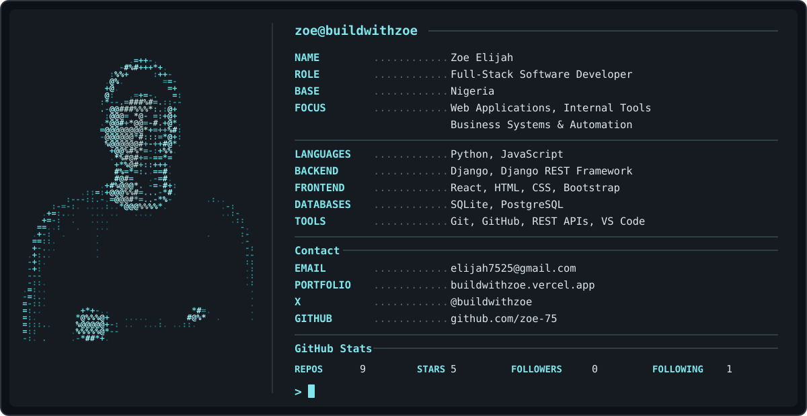

<!--
GitHub Profile README for https://github.com/zoe-75
Keep this README.md and the assets/ folder together in the public repository named exactly: zoe-75
-->

  
   
   
  
  &nbsp;
  
  &nbsp;
  

