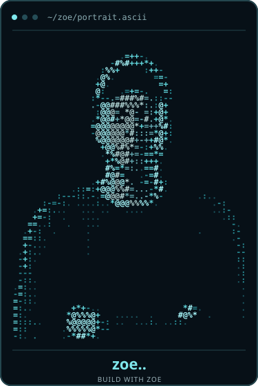

<!-- GitHub Profile README for https://github.com/zoe-75 -->
<!-- Put this file in a PUBLIC repository named exactly: zoe-75 -->

<div align="center">

# zoe..

**FULL-STACK DEVELOPER** &nbsp;·&nbsp; **WEB APPLICATIONS** &nbsp;·&nbsp; **INTERNAL TOOLS** &nbsp;·&nbsp; **AUTOMATION**

[](https://buildwithzoe.vercel.app/)
[](https://github.com/zoe-75)

</div>

<table>
<tr>
<td width="40%" align="center" valign="top">
  
</td>
<td width="60%" valign="top">

<h3><code>zoe-75@github</code></h3>

<pre>
──────────────────────────────────
Name      Zoe
Role      Full-Stack Software Developer
Focus     Web Apps · Internal Tools
          Business Automation
──────────────────────────────────
Backend   Python · Django · DRF
Frontend  React · TypeScript · JavaScript
Data      PostgreSQL · SQLite
Tools     Git · GitHub · REST APIs
──────────────────────────────────
Building  Practical software for
          real business problems
Status    Learning · Building · Shipping
</pre>

<a href="https://buildwithzoe.vercel.app/"><strong>↗ Explore my portfolio</strong></a>

</td>
</tr>
</table>

## `$ whoami`

I'm **Zoe**, a software developer interested in the systems behind useful products: reliable backends, APIs, web applications, internal tools, and automation.

I work with **Django and REST APIs** on the backend, and **React, TypeScript, and modern web technologies** on the frontend. My goal is to build software that addresses a real need and stays maintainable as it grows.

## `$ ls ~/toolbox`

**Backend & data**


**Frontend**


**Workflow**


## `$ ls ~/selected-work`

| Project | What it does | Status |
|:--|:--|:--|
| [BRM Performance Analyzer](https://brmsummary.netlify.app/) | Internal performance reporting and business insights | Delivered and in use |
| [Mahilla Digital Consult](https://mahilladigitalconsult.netlify.app/) | Corporate website and service discovery | Delivered and in use |
| [FAB Ventures](https://fabventures.netlify.app/) | Business-facing website | Delivered and in use |
| [ARN Auto Service](https://arnautoservice.vercel.app/) | Independent concept for an automotive service business | Business pitch concept |
| **KRA8T** | Software platform for structured learning, projects and career development | In development |

**More projects, screenshots and case studies:** [buildwithzoe.vercel.app](https://buildwithzoe.vercel.app/)

## `$ cat current-focus.txt`

```text
> Building dependable Django APIs and authentication systems
> Developing practical business software and internal tools
> Strengthening React + TypeScript frontend engineering
> Documenting the decisions, bugs, and lessons behind the code
```

## `$ github --stats`

<div align="center">


</div>

<sub>Stats are dynamically generated from public GitHub activity. Their availability depends on a third-party service.</sub>

## `$ connect --with zoe`

**Building something useful?** You can explore my work and reach me through my portfolio.

[](https://buildwithzoe.vercel.app/)
[](https://github.com/zoe-75)

---

<div align="center">
<sub>Build thoughtfully. Solve real problems. Keep learning.</sub>
</div>
